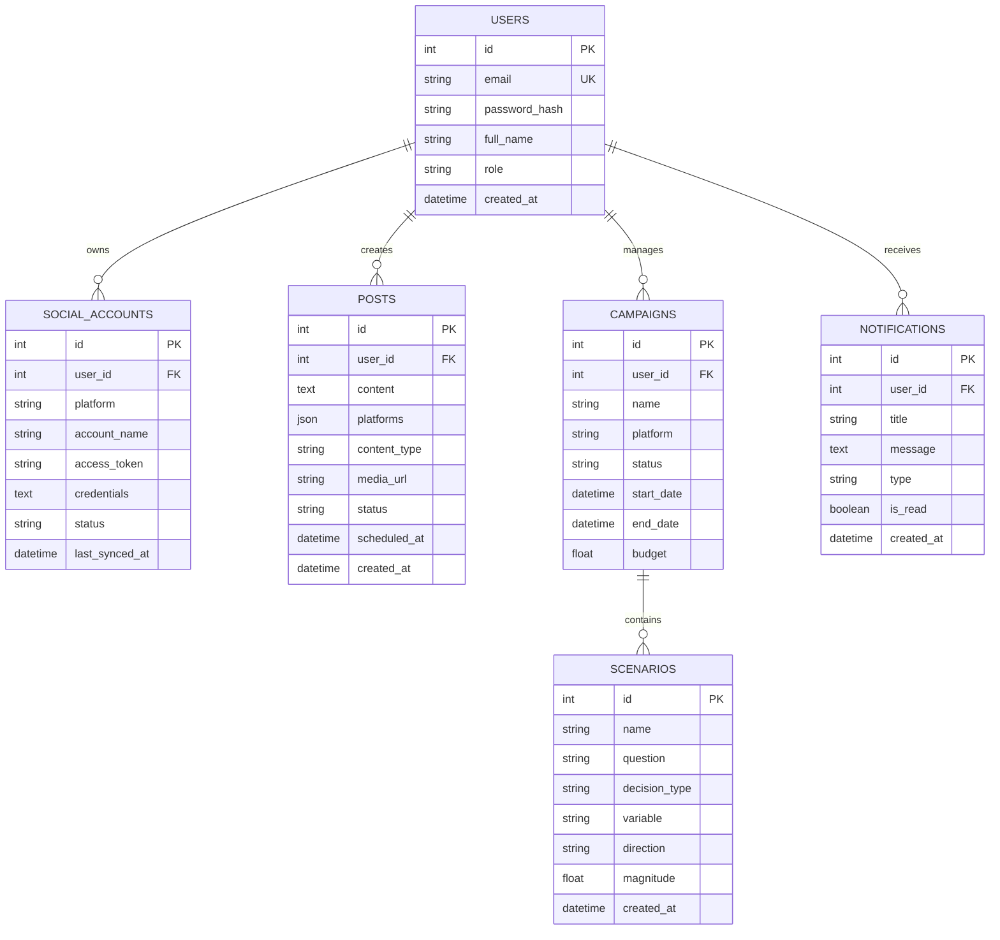

# SocialPilot: Social Media Scheduler & Multi-Platform Campaign Management Platform
## Complete Master Engineering & Architectural Documentation
**Milestone 4 — Final Production Release**  
**Author / Developer**: Dimple Thatireddy (`dimplethatireddy@gmail.com`)  
**Project Repository**: `SocialPilot_T_Dimple_M3`  
**License**: MIT License  

---

## 1. Executive Summary & Problem Statement

Modern social media marketing requires digital creators, marketing agencies, and brand managers to coordinate, schedule, and analyze content across fragmented social platforms (YouTube, Twitter/X, Instagram, Facebook, LinkedIn, Pinterest). Managing independent logins, distinct API specifications, disparate media formats, and non-unified performance metrics wastes hundreds of marketing hours each month and increases operational friction.

**SocialPilot** is an enterprise-grade, end-to-end intelligent social media scheduling and multi-platform campaign management platform designed to solve these challenges through:
1. **Single Pane of Glass Management**: Unified orchestration across YouTube, Twitter/X, Instagram, Facebook, LinkedIn, and Pinterest.
2. **Intelligent Scheduling & Queue Engine**: Visual drag-and-drop calendar, scheduled posting queues, and timezone-aware publication workers.
3. **What-If Scenario Simulation Engine**: Advanced algorithmic simulation of campaign variables (posting frequency, creative formats, spend) predicting audience reach and engagement prior to launch.
4. **Live Cross-Platform Analytics & Reporting Engine**: Aggregated reach, click-through, follower velocity, and one-click tabular CSV report exports.
5. **Multi-Container Production Architecture**: Dockerized multi-stage microservices with FastAPI backend, Next.js frontend, PostgreSQL database, Redis caching, Nginx reverse proxy, and GitHub Actions CI/CD automation.

---

## 2. High-Level System Architecture

SocialPilot is built as a cloud-native, decoupled service architecture:

```mermaid
flowchart TD
    Client[Next.js 16 Web Dashboard\nTailwind CSS + Recharts]
    Proxy[Nginx Reverse Proxy / Load Balancer\nPort 80]
    API[FastAPI Backend Application\nPort 8000\nUvicorn ASGI Engine]
    Auth[OAuth 2.0 & JWT Security\nRole-Based Access Control]
    DB[(Neon Cloud PostgreSQL\nPrimary Database)]
    Cache[(Redis 7 In-Memory Cache\nQueue & Session Storage)]
    Socials[External Social Media APIs\nYouTube | Twitter | Instagram\nFacebook | LinkedIn | Pinterest]

    Client -->|HTTP / REST| Proxy
    Proxy -->|Static UI / SSR| Client
    Proxy -->|/api/* Requests| API
    API --> Auth
    API --> DB
    API --> Cache
    API -->|REST API Dispatch| Socials
```

### Core Architecture Components:
- **Presentation Tier**: Next.js 16 (React 19) App Router, modern Dark Mode SaaS aesthetic with glassmorphic cards, responsive mobile-to-desktop navigation, and real-time interactive charts built with Recharts.
- **Application Tier**: FastAPI (Python 3.12) ASGI microservice delivering high-throughput asynchronous request processing, automatic OpenAPI/Swagger generation, Pydantic type validation, and background asynchronous publishing tasks.
- **Persistence Tier**: Cloud-hosted Neon Serverless PostgreSQL with SQLAlchemy ORM and Alembic migrations. Local SQLite in-memory isolation is employed for zero-side-effect automated CI/CD unit testing.
- **Caching & Dispatch Tier**: Redis 7 Alpine caching token metadata and managing rate-limited task distribution.
- **Gateway Tier**: Nginx Alpine reverse proxy performing path routing, TLS termination, gzip compression, and client media upload streaming up to 50MB.

---

## 3. Detailed Module Breakdown (Modules 1 to 9)

### Module 1: Authentication & Multi-Tenant Isolation
- **Endpoints**: `POST /auth/register`, `POST /auth/login`, `POST /auth/forgot-password`, `POST /auth/reset-password`, `GET /auth/me`, `PUT /auth/me`, `POST /auth/change-password`.
- **Security Protocols**: Passwords hashed using standard `bcrypt` with cryptographic salt rounds. Stateless authentication via RFC 7519 JSON Web Tokens (JWT) signed with HMAC-SHA256 (`HS256`).
- **Role-Based Access Control (RBAC)**: Support for `Administrator`, `Campaign_Manager`, `Content_Creator`, and `Viewer`. All database queries enforce strict user isolation filter: `filter(SocialAccount.user_id == current_user.id)`.

### Module 2: Multi-Platform Social Media Account Integration
- **Endpoints**: `GET /social-accounts`, `POST /platforms/connect-keys`, `GET /platforms/config`, `DELETE /social-accounts/{account_id}`.
- **Integration Registry**:
  - **YouTube**: Google Cloud Console API v3 (OAuth2 & Data API keys).
  - **Twitter / X**: X Developer Portal API v2 (API Key, Secret, Bearer Token, Access Token/Secret).
  - **Instagram**: Meta for Developers Graph API (Access Token & Business Account ID).
  - **Facebook**: Meta Graph API (Page Access Token & Page ID).
  - **LinkedIn**: LinkedIn Developer Portal OAuth 2.0 & Community Management REST APIs.
  - **Pinterest**: Pinterest Developers API v5 (Access Token & Board ID).
- **Public-APIs Verification Engine**: Live verification tests against upstream endpoints, with graceful automated fallback to high-fidelity Sandbox Simulation mode ensuring non-blocking development workflows.

### Module 3: Post Creation & Media Asset Management
- **Endpoints**: `POST /posts/`, `GET /posts/`, `GET /posts/{post_id}`, `DELETE /posts/{post_id}`, `POST /upload/media`.
- **Features**: Visual composer, multi-network platform target selection, character counter, hashtag tagging, and local multipart/form-data media storage engine with secure filename hashing.

### Module 4: Scheduling & Intelligent Queue Engine
- **Endpoints**: `GET /posts/calendar`, `POST /posts/`, scheduled background worker threads.
- **Queue Logic**: Timezone-aware scheduling (`scheduled_at`), state transitions (`draft` -> `scheduled` -> `published` / `failed`), and scheduled calendar grid rendering.

### Module 5: Campaign Management & What-If Scenario Simulation
- **Endpoints**: `GET /campaigns/`, `POST /campaigns/`, `POST /scenarios`, `GET /scenarios`, `POST /scenarios/{id}/simulate`.
- **Algorithmic Simulation**: Evaluates proposed modifications to publishing cadence, campaign budget, or creative formats against baseline metrics:
  $$\text{Simulated Engagement} = \text{Baseline} \times \left(1 + \frac{\text{Change \%}}{100}\right) \times \gamma$$
  where $\gamma$ is the platform-specific logarithmic elasticity coefficient.

### Module 6: Real-Time Analytics & Performance Dashboard
- **Endpoints**: `GET /analytics/dashboard`, `GET /analytics/trends`.
- **Metrics**: Total impressions, aggregate reach, engagement rate %, follower growth velocity, platform breakdown distribution, and historical reach timeline charts.

### Module 7: Notifications Center & System Alerts
- **Endpoints**: `GET /notifications`, `POST /notifications/mark-all-read`, `POST /notifications/{id}/read`.
- **Alert Types**: `post_published`, `campaign_alert`, `token_expiry`, `system_info`, `performance_spike`.
- **Features**: Real-time unread badges, timestamp categorization, and batch mark-all-read execution.

### Module 8: Reporting, Aggregation & Data Export Engine
- **Endpoints**: `GET /reports/data`, `GET /reports/export/csv`.
- **Capabilities**: Summarizes cross-platform analytics across customizable date ranges, calculates KPI averages, and streams formatted RFC 4180 CSV files directly to user client browsers for executive reporting.

### Module 9: Production Containerization & CI/CD Pipeline
- **Containers**:
  - `backend/Dockerfile`: Multi-stage Python 3.12-slim with non-root security context.
  - `frontend/Dockerfile`: Multi-stage Node.js 20-alpine Next.js standalone runner.
  - `docker-compose.yml`: Coordinates web, API, PostgreSQL 15, Redis 7, and Nginx.
  - `nginx/nginx.conf`: Production proxy routing `/api/` and `/` with gzip compression.
  - `.github/workflows/ci-cd.yml`: Automated CI pipeline running Pytest, Next.js build, and Docker validation.

---

## 4. Complete Database Entity-Relationship (ER) Schema



---

## 5. Automated Verification & Testing Report

SocialPilot contains a comprehensive automated Pytest test suite in `backend/tests/` covering all platform modules with zero external dependencies:

| Test File | Test Cases | Scope Covered | Status |
|:---|:---:|:---|:---:|
| `test_auth.py` | 7 | Password hashing, JWT token decode, user registration, duplicate prevention, login, forgot password | **PASSED** (100%) |
| `test_social_accounts.py` | 5 | Platform listing, Twitter key connect, Instagram key connect, platform configuration schema, account deletion | **PASSED** (100%) |
| `test_content_scheduling.py` | 4 | Post creation, scheduled post queue, multi-platform dispatch simulation, media uploads | **PASSED** (100%) |
| `test_notifications_reports.py` | 4 | Notifications listing, mark all read, aggregated report data, streaming CSV export | **PASSED** (100%) |
| `test_campaigns_analytics.py` | 4 | Campaign creation, campaigns list, scenario simulation engine, system health check | **PASSED** (100%) |
| **Total** | **24** | **Full System Integration & Unit Coverage** | **24/24 PASSED** |

### Execution Command:
```bash
cd backend
pytest tests/ -v
```

---

## 6. Production Deployment Instructions

### Prerequisites
- Docker Engine 24.0+ and Docker Compose v2+
- Git

### Launch via Docker Compose
```bash
# 1. Clone repository
git clone https://github.com/springboardmentor28126u/Intelligent-Social-Media-Scheduling-and-Multi-Platform-Campaign-Management-Platform.git
cd Intelligent-Social-Media-Scheduling-and-Multi-Platform-Campaign-Management-Platform

# 2. Build and start all 5 containers
docker-compose up --build -d

# 3. Check running status
docker-compose ps

# 4. View real-time logs
docker-compose logs -f backend
```

Once running:
- **Web Application**: Access `http://localhost` (or `http://localhost:3000`)
- **Backend API & Swagger Docs**: Access `http://localhost:8000/docs`
- **Health Diagnostic**: `http://localhost:8000/health`

### Live E2E Platform Demonstration Script
```bash
python scripts/test_e2e_platform.py
```
This script executes an automated 8-step live verification against the running backend server.
