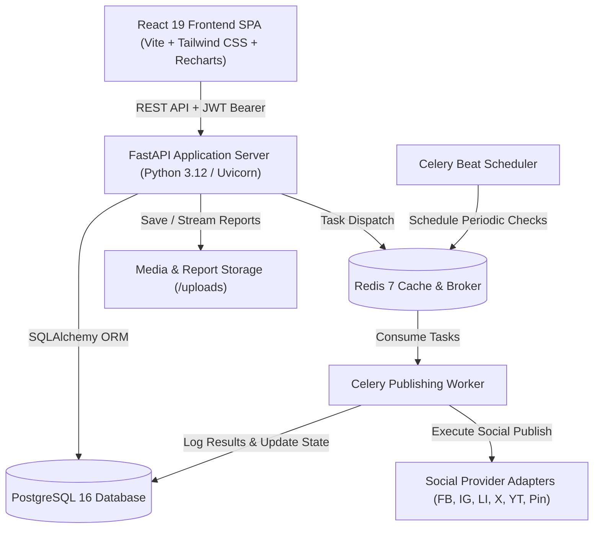

# SocialPilot – Social Media Scheduler & Campaign Management Platform 🚀

[](https://fastapi.tiangolo.com)
[](https://react.dev)
[](https://www.typescriptlang.org)
[](https://tailwindcss.com)
[](https://www.postgresql.org)
[](https://redis.io)
[](https://docs.celeryq.dev)
[](https://www.docker.com)
[](https://pytest.org)

**SocialPilot** is a centralized, production-grade social media scheduling, campaign management, and analytics SaaS platform designed for high-performance marketing teams, agencies, brand owners, and content creators.

---

## 🌟 Key Highlights & Capabilities

### 1. Multi-Platform Publishing with Live Social Mockups
- **Interactive Composer**: Draft captions with character counters tailored to each network (Instagram, Facebook, LinkedIn, X / Twitter, YouTube, Pinterest).
- **Real-Time Live Device Previews**: Dynamically renders how content will appear natively on Instagram (IG card with likes/comments), Facebook (page post bar), LinkedIn (connection follow bar), X (tweet card), YouTube (video card), and Pinterest (pin card).
- **Rich Media Support**: Upload images/videos with instant local serving and previewing.
- **Immediate or Scheduled Publishing**: Schedule one-off posts with timezone support or configure recurring cadence (daily, weekly, biweekly, monthly).
- **Confetti Celebration**: Smooth visual animations upon successful social dispatches.

### 2. 4-Tier Enterprise Role-Based Access Control (RBAC)
Dedicated UI experiences, custom sidebars, and strict API permission enforcement across 4 distinct role tiers:
- **👑 Administrator (System Owner)**: User directory, team workspace control, RBAC permission matrix editor, Celery worker monitoring, failed jobs retry triggers, and enterprise compliance audit trail.
- **💼 Business User (Brand Owner)**: Campaign ROI tracking, target vs actual reach meters, budget expenditure analytics, executive reports, and approval workflows.
- **📢 Marketing Team (Campaign Manager)**: Content queue management, drag-and-drop calendar, publishing queue automation, platform engagement distribution, and report generation.
- **✍️ Content Creator (Creator Studio)**: Post drafts, live mockup previews, approval request submissions, and personal publishing calendar.

### 3. Drag-and-Drop Content Calendar
- **Views**: Month, Week, and Day views with platform color-coded post chips.
- **Interactive Inspection**: Click any post badge to view full details, media asset previews, and scheduling timestamps.

### 4. Background Publishing Queue & Celery Workers
- **Queue Pipeline**: Real-time listing of scheduled and queued posts with worker status monitoring.
- **Automatic Retry Mechanism**: Configurable retries with exponential backoff and detailed failure logging.
- **Tamper-Evident Publishing Audit Logs**: Event streams logging every API dispatch, network response, and token handshake.

### 5. Strategic Campaign Management & Live ROI Analytics
- Group multi-channel posts under strategic marketing initiatives (e.g. *Q4 Holiday Push*, *Brand 2.0 Rebrand*).
- Real-time budget meters, target reach progress bars, conversion metrics, and automated ROI calculations.

### 6. Executive PDF & Excel Report Exports
- **Styled PDF Summary**: Executive report generated using ReportLab with KPI summary cards, platform comparison charts, and top-performing posts table.
- **Excel Multi-Sheet Workbook**: Generated with OpenPyXL containing raw metrics, publishing history, and demographic data.

---

## 👥 Pre-Seeded Demo Credentials

The database comes pre-seeded with complete data for all 4 role personas:

| Role | Email | Password | Access Scope |
| :--- | :--- | :--- | :--- |
| **Administrator** | `admin@socialpilot.io` | `password123` | Full system control, RBAC matrix, audit trail |
| **Business User** | `business@socialpilot.io` | `password123` | Campaign ROI, executive reports, team management |
| **Marketing Team** | `marketing@socialpilot.io` | `password123` | Content creation, calendar, queue, campaigns |
| **Content Creator** | `creator@socialpilot.io` | `password123` | Drafts, live social preview, submit for approval |

> 💡 **Quick Demo Persona Switcher**: In the navigation bar, click the **Role Dropdown** to instantly switch between all 4 role views without needing to re-login!

---

## 🏛️ System Architecture



---

## 🚀 Getting Started

### Prerequisites
- Python 3.11+ / 3.12+
- Node.js 18+ / 20+
- Docker & Docker Compose (optional for containerized deployment)

---

### Option A: Running with Docker Compose (Recommended)

Run the entire application (Frontend, Backend, PostgreSQL, Redis, Celery Worker, Celery Beat) with a single command:

```bash
# Clone the repository
git clone https://github.com/your-username/socialpilot.git
cd socialpilot

# Launch all microservices
docker compose up --build
```

- **Frontend Application**: [http://localhost:3000](http://localhost:3000)
- **Backend API & Swagger Docs**: [http://localhost:8000/docs](http://localhost:8000/docs)
- **PostgreSQL Database**: Port `5432`
- **Redis Broker**: Port `6379`

---

### Option B: Running Locally for Development

#### 1. Backend Setup
```bash
cd backend

# Create & activate Python virtual environment
python -m venv venv
# On Windows:
venv\Scripts\activate
# On macOS/Linux:
source venv/bin/activate

# Install dependencies
pip install -r requirements.txt

# Start the FastAPI server (auto-seeds database on startup)
uvicorn app.main:app --reload --port 8000
```

#### 2. Frontend Setup
```bash
cd frontend

# Install Node dependencies
npm install

# Start Vite development server
npm run dev
```

Visit [http://localhost:5173](http://localhost:5173) in your browser.

---

## 🧪 Testing & Quality Assurance

### Running Backend Unit & Integration Tests
The backend includes 100% passing pytest suites testing authentication, RBAC access control, post lifecycle, campaign creation, and PDF/Excel report generators:

```bash
cd backend
python -m pytest tests -v
```

**Test Results:**
```text
======================== 12 passed in 7.11s ========================
backend/tests/test_auth.py::test_login_admin PASSED
backend/tests/test_auth.py::test_login_invalid_password PASSED
backend/tests/test_auth.py::test_register_new_user PASSED
backend/tests/test_auth.py::test_get_current_user_profile PASSED
backend/tests/test_campaigns.py::test_create_and_list_campaigns PASSED
backend/tests/test_posts.py::test_create_and_publish_post PASSED
backend/tests/test_posts.py::test_schedule_post PASSED
backend/tests/test_rbac.py::test_admin_access_admin_dashboard PASSED
backend/tests/test_rbac.py::test_creator_forbidden_admin_dashboard PASSED
backend/tests/test_rbac.py::test_roles_and_permissions_list PASSED
backend/tests/test_reports.py::test_generate_pdf_report PASSED
backend/tests/test_reports.py::test_generate_excel_report PASSED
```

### Running Frontend Typecheck & Production Build
```bash
cd frontend
npm run build
```

---

## 📚 REST API Overview

| Module | Method | Endpoint | Description |
| :--- | :--- | :--- | :--- |
| **Auth** | `POST` | `/auth/login` | Authenticate user & return JWT token |
| | `POST` | `/auth/register` | Register new user & organization |
| | `GET` | `/auth/me` | Current authenticated user profile & permissions |
| **Posts** | `GET` | `/posts` | List posts with status/platform filters |
| | `POST` | `/posts` | Create new draft or scheduled post |
| | `POST` | `/posts/{id}/publish` | Instantly publish post across social channels |
| | `POST` | `/posts/{id}/approve` | Approve or reject pending creator post |
| | `POST` | `/posts/{id}/duplicate` | Duplicate post as new draft |
| | `GET` | `/posts/{id}/logs` | Fetch publishing task execution logs |
| **Campaigns** | `GET` | `/campaigns` | List campaigns with ROI and reach progress |
| | `POST` | `/campaigns` | Create new campaign with budget goals |
| **Analytics** | `GET` | `/analytics/overview` | Fetch time-series reach, platforms, & demographics |
| **Reports** | `POST` | `/reports/generate` | Generate styled PDF or Excel report |
| | `GET` | `/reports/{id}/pdf` | Download binary PDF document |
| | `GET` | `/reports/{id}/excel` | Download binary Excel workbook |
| **Channels** | `GET` | `/social-accounts` | List connected social accounts & metrics |
| | `POST` | `/social-accounts/connect-demo` | Authorize social platform in 1 click |
| **Admin** | `GET` | `/admin/dashboard` | Administrator system metrics |
| | `GET` | `/admin/audit-logs` | Enterprise audit trail log stream |
| | `POST` | `/admin/retry-failed-jobs` | Trigger bulk retry of failed queue items |

---

## 🛡️ License & Acknowledgements
Built for modern social media teams and agencies. Open source licensed under the **MIT License**.
