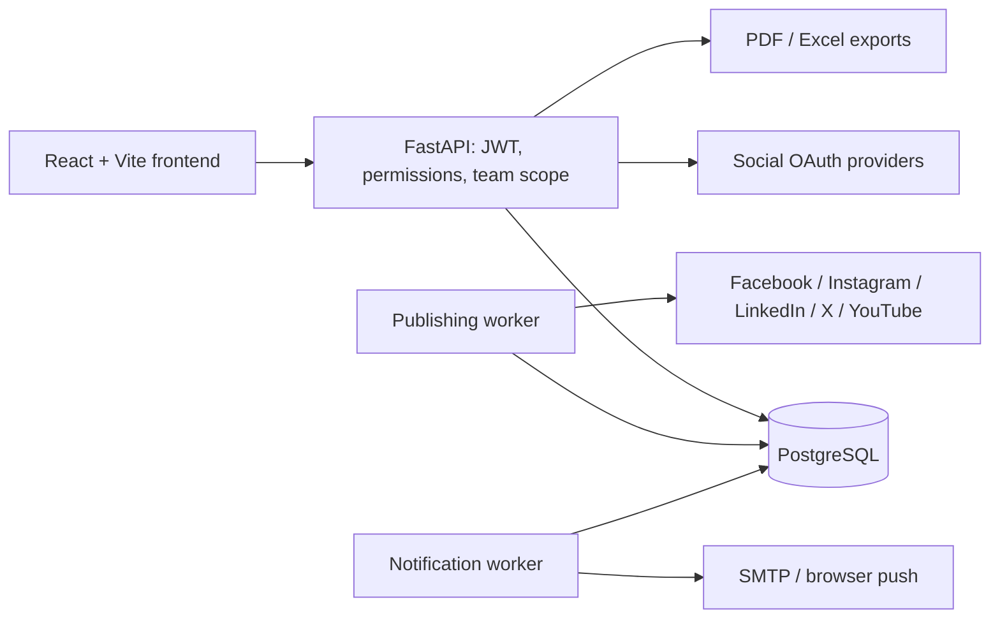

# SocialPilot

SocialPilot is a React/FastAPI workspace for social accounts, drafts, approvals, scheduling, campaigns, analytics and reports. This checkout is prepared for deployment, but is **not deployed**. Docker runtime verification passed with disposable data; live provider/delivery checks remain outstanding.

## Architecture



PostgreSQL holds users, workspace membership, pending invitations, content, versioned approvals, campaigns, durable jobs, metrics and notification outbox records. A team owns content through a non-login storage principal; membership checks isolate it from personal workspaces. Workers claim durable jobs and handle retries/uncertain outcomes. MongoDB is optional connectivity support; Redis and Celery are not used. This differs from the reference stack but keeps queue ownership and transactions in PostgreSQL.

The frontend lazy-loads pages with Suspense. Charts load separately when analytics/reporting pages need them. Authentication tokens remain in browser local storage; use HTTPS and treat XSS prevention as a release concern.

## Team workflow and visibility

Only `content_creator` has `publish:write`, in both personal and team workspaces.
Administrators and managers cannot connect accounts, schedule, publish, retry or
run publishing jobs. Team ownership and the membership admin flag provide management
rights separately: an owner can select creator and still manage the team, or select
administrator and manage without publishing.

Manager-authored content follows draft -> manager approval -> **Awaiting creator**
-> creator final approval -> creator schedules/publishes. Every review is recorded
against its revision; edits, including campaign moves, reset approval and increment
the revision. Creator-authored revisions publish directly regardless of the team's
approval setting. The worker checks the scheduling actor's current creator role,
content authorization and campaign access immediately before sending.

Campaigns are private by default. The creator, assigned members and workspace
managers can access them; business users see only whole-team-shared campaigns.
The same filter applies to linked posts, analytics, reports, exports and notifications.
Account-wide follower statistics remain account-wide rather than campaign metrics.

Migrations 011-013 preserve records. Old campaigns remain accessible to workspace
admins and are assigned to current creator members because historical account
connector identity was not recorded. Old team jobs with unknown scheduling actors
fail safely. Migration 014 repairs missing author roles and IDs on personal posts
from the owning real account, normalizing legacy user/admin roles and preserving
known revision roles. Team posts remain unchanged and require fresh creator review
or recreation when historical authorship cannot be established. See [role policy](Backend/ROLE_ACCESS.md)
and [workflow change report](WORKFLOW_CHANGE_REPORT.md).

## Local setup

Requirements: Python 3.12+, Node 24, PostgreSQL 17, and PostgreSQL client tools for backups. Commands below are run in a terminal; configure secrets privately in its process environment first.

Required backend variables: `DATABASE_URL`, `JWT_SECRET_KEY`, `SOCIAL_TOKEN_KEY`. Set `APP_ENV=development`, and optionally `CORS_ORIGINS=http://localhost:5173`. `DATABASE_URL` uses a PostgreSQL URL; special password characters must be URL-encoded. Generate a strong random JWT secret and a Fernet key in a private credential workflow.

**Configuration comes from environment variables only.** The application does not load dotenv files. Never read, print, edit or commit any `.env` files as part of this workflow. Existing values must be supplied by the operator through an approved secret mechanism.

```powershell
cd Backend
python -m venv venv
.\venv\Scripts\python.exe -m pip install -r requirements.txt
# Back up the configured PostgreSQL database, then apply the single migration chain.
.\venv\Scripts\python.exe backup_and_migrate.py
.\venv\Scripts\python.exe -m uvicorn main:app --host 127.0.0.1 --port 8000
```

In another terminal:

```powershell
cd frontend
npm ci
$env:VITE_API_URL = 'http://localhost:8000'
npm run dev
```

For the existing real local PostgreSQL database, stop the API and both workers,
then run this from PowerShell (do not load any `.env` file):

```powershell
Set-Location 'C:\Users\Aryan\OneDrive\Desktop\SocialPilot_1'
& .\tools\migrate-local.ps1
```

The helper prompts for the real local `DATABASE_URL` with hidden input, rejects
remote targets and the disposable test cluster, invokes the existing
`backup_and_migrate.py`, then checks the database reached `a21c4e810014`. It prints
SUCCESS or FAILURE without connection diagnostics/secrets. Backups default to
`C:\SocialPilot_backups`, outside OneDrive; the helper creates it if missing.
Override with `& .\tools\migrate-local.ps1 -BackupDir 'D:\SocialPilot_backups'`.
Keep backup directories private and outside synced folders; existing `backups/`
remains ignored and is not moved or deleted by this change.
Process settings are restored afterward; no API/worker is started. Enter the URL
privately using your existing credentials (URL-encode special password characters).
A failure after upgrade may mean changes were applied but verification failed;
keep workers stopped and preserve backups. Migration 014's downgrade intentionally
retains repaired values, since removing them would destroy valid authorship.

`GET /health` returns `{"status":"ok"}` when the database responds, otherwise HTTP 503. Production startup checks both secrets and explicit CORS origins. Login is limited across web processes to 10 attempts/email and 30 attempts/client IP per 15 minutes; HTTP 429 includes `Retry-After`. Configure trusted proxy forwarding before public traffic.

The current single Alembic head is `a21c4e810014`, in one linear migration chain. The user's existing database has not been upgraded by this preparation. Back up and migrate before running the new backend against it.

## One-command team demo

After setting `DEMO_PASSWORD` privately (at least 12 characters) and migrating a local/staging database, run from `Backend`:

```powershell
.\venv\Scripts\python.exe seed_team_demo.py
```

Sign in as `demo-admin@example.com`, `demo-creator@example.com`, or `demo-manager@example.com`, using that password. Choose **SocialPilot Demo Team**. Four drafts demonstrate draft, pending, approved and rejected states. The script is idempotent, preserves existing passwords and refuses production mode. It does not connect social accounts, schedule jobs, or send notifications. For richer sample analytics, use **Load demo data** in a separate personal workspace; samples are never published.

Read [the five-minute demo](DEMO_SCRIPT.md) and [final report outline](FINAL_REPORT_OUTLINE.md).

## Docker (verified with disposable data)

Docker Desktop/Engine with Compose is required. The local stack passed build, health, authentication, frontend proxy, migration and worker checks on 6 October 2026. See [Docker runbook](docs/DOCKER.md) for prerequisites, configuration, exact commands and teardown.

1. If `.env.docker` does not exist, copy the public dummy `.env.docker.example` to it. Do not copy protected files or real credentials. `.env.docker` is ignored by Git and excluded from build contexts.
2. Start the database, API and frontend only:

```powershell
docker compose -p socialpilot-docker-test --env-file .env.docker up --build -d --wait postgres backend frontend
docker compose -p socialpilot-docker-test --env-file .env.docker ps
docker compose -p socialpilot-docker-test --env-file .env.docker exec backend python smoke_docker.py
```

3. Open `http://localhost:15173`; API health is `http://127.0.0.1:18000/health`. nginx serves the SPA and proxies `/api` to the backend. PostgreSQL has no host port. The named database volume persists across restarts. The backend runs `alembic upgrade head` before Gunicorn/Uvicorn starts. Healthchecks sequence startup. Do not publish secrets in build arguments.
4. The smoke script exercises SPA routing, login, posts, scheduling, PDF and Excel with synthetic demo-marked data. It retains its records and cancels its jobs; it is restricted to the Compose `postgres` host. This is not a live OAuth test.
5. The separate publishing worker was verified using this empty, disposable database and no provider credentials. The Docker runbook explicitly selects that service; notification-worker stays off. Real publishing or delivery requires separate authorization.

Use `docker compose -p socialpilot-docker-test --env-file .env.docker --profile workers down` to remove this stack's containers and network while keeping data. Use the runbook's reset command only for its throwaway volume. Workers reuse the non-root backend image. Browser OAuth uses direct backend `/oauth/.../callback` URLs, not nginx `/api/...` callbacks.

## Tests

From the repository root on Windows:

```powershell
powershell -NoProfile -ExecutionPolicy Bypass -File tools/check-step.ps1
```

This sets isolated test values, disables dotenv loading, runs backend tests and checks the Alembic head, then runs frontend lint, production build and Node tests. The frontend bundle test intentionally requires that build. Three PostgreSQL-only tests skip in the default mode.

`-PostgresTest` uses a disposable PostgreSQL cluster on `127.0.0.1:55439`, user `socialpilot_test`, database `postgres`. It must already be started. For the final checks it was initialized under ignored `tmp/qa-postgres`, then stopped after testing. Never point these disposable-schema tests at production.

Current detailed results, provider coverage, known limitations and historical evidence are in [TEST_REPORT.md](TEST_REPORT.md). [STEP_LOG.md](STEP_LOG.md) records changes/checks per step.

## Providers and production

Facebook, Instagram, LinkedIn, X and YouTube adapters are implemented and have mocked regression coverage. This preparation did not authorize accounts, alter provider settings, or perform live publishing. API plans, permissions, review and token lifetimes still apply. Pinterest, carousels, stories/reels, advanced audience demographics/geography and load benchmarks remain outside the implemented coverage.

Native PDF exports use a limited built-in font; Hindi and emoji can appear as missing glyphs. The PDF states this limitation. Use Excel for Unicode-preserving exports.

[DEPLOYMENT_PREPARATION.md](DEPLOYMENT_PREPARATION.md) contains exact Vercel/Render/Neon settings, the complete variable inventory, approved-transfer sequence and rollback plan. [OAuth checklist](Backend/OAUTH_CALLBACK_CHECKLIST.md) lists callback paths. [Collaboration guide](Backend/TEAMS_APPROVALS_NOTIFICATIONS.md) explains teams, reviews and delivery.

No deployment or real email is authorized yet. Before public team onboarding, add email-ownership verification or restrict registration: current invitations match the registration email. Docker verification passed with dummy data; cloud restore rehearsal, production proxy behavior, and live integrations remain release gates.

## Current roles — view-only policy (head `a21c4e810014`)

| Role | Navigation | Actions |
|---|---|---|
| Content Creator | Overview, Campaigns, Posts, Schedule, Calendar, Social Accounts, Analytics, Engagement, Reports, Notifications, Teams, Content Approval | Draft/edit, reviews and creator final approval, connect accounts, schedule/publish/retry, analytics sync; team demo mutations additionally require manage rights |
| Marketing Manager | Overview, Campaigns, Posts, Content Approval, Analytics, Engagement, Reports, Notifications, Teams | Draft/edit, manager review, engagement-note API updates; cannot publish, connect, sync or mutate demo data |
| Business User (view only) | Overview, Campaigns, Posts, Analytics, Engagement, Reports, Notifications, Teams | Read permitted accounts/posts/campaigns/analytics/reports; no content, review, sync, demo or publishing actions |
| Administrator (view only) | Overview, Campaigns, Posts, Analytics, Engagement, Reports, Notifications, Teams | Same three read permissions as Business User; no platform administration or content actions |

Business User and Administrator have exactly `accounts:read`, `posts:read`, `analytics:read`. Creator and manager permission sets are unchanged. All platform admin routes are removed (404 for every role); `/me/permissions` remains available. Users and Roles & Permissions navigation and the AdminUsers page are removed. Teams contains a read-only role reference and retains all four invite/role options.

Team management is a separate exception: only the owner or an explicit `is_admin` delegate can manage an existing team, regardless of their content role. Administrator role alone grants no management. View-only roles cannot create teams, author content, review, approve, sync, publish or connect accounts even when they hold management rights. Existing campaign visibility remains unchanged, including Business User access only to team-shared campaigns. No migration or real-database operation is needed; head stays `a21c4e810014`.

## Pre-deployment API hardening

The Mongo connectivity endpoint and module have been retired; the application uses PostgreSQL. Former platform admin endpoints are removed and return 404, including anonymous requests. `/me/permissions` remains available. Business User and Administrator retain their three read permissions.

Set `APP_ENV=production` before starting the backend: `/docs`, `/redoc` and `/openapi.json` are disabled. Development keeps all three. This setting does not replace the required production secrets and CORS configuration. No migration is required; Alembic head remains `a21c4e810014`.

Hardening verification: 139 backend tests and 22 frontend tests passed, with lint/build and migration/schema checks. PyJWT is pinned to 2.15.0 after a minor security upgrade; the final requirements audit found no known vulnerabilities. The deployment runbook records the initial advisories and audit limits.

## Local run helpers

Run these commands from the SocialPilot_1 root in separate PowerShell terminals, leaving each service terminal open. The helpers are explicit operator tools: the application itself still reads process environment variables only. The backend/worker helpers load your existing Backend configuration privately, without generating or changing secrets. The social configuration overrides duplicate keys from the main configuration. Both files must exist, and DB_USER, DB_PASSWORD, DB_HOST, DB_PORT and DB_NAME must be present; the helper builds DATABASE_URL with escaped credentials.

1. Start the tunnel: `& .\tools\start-tunnel.ps1`.
2. In another terminal, update callbacks: `& .\tools\set-tunnel-host.ps1`. This probes localhost ports 20241–20250. Alternatively supply `-TunnelHost https://name.trycloudflare.com/` from your known quick-tunnel address.
3. Copy the two printed Instagram/Facebook callback URLs into the Meta developer console. The updater changes only their host spans; their stored callback paths remain unchanged. Both HTTPS redirect lines must exist exactly once. UTF-8 input is required; output is UTF-8 without BOM. Line endings and other content are preserved (an existing BOM is removed as required).
4. Start or restart the backend: `& .\tools\start-backend.ps1`.
5. After reviewing queued posts, start the publishing worker in another terminal: `& .\tools\start-worker.ps1`. It uses a 10-second interval and the existing original social-token encryption key. It can publish due jobs. Notification/email workers are not started by these helpers.

The quick-tunnel address changes after every tunnel restart. Repeat step 2, update the Meta callbacks, and restart the backend. The tunnel may start before the backend; requests cannot succeed until the backend is running. Process output is drained without being printed or logged so driver/provider errors cannot reveal secrets. Helpers print only generic status/errors; use Ctrl+C to stop a running helper and its child service. No configuration file should be pasted into chat or committed.

If Windows blocks script execution, launch an individual helper with `powershell.exe -NoProfile -ExecutionPolicy Bypass -File .\tools\start-backend.ps1` (substitute the helper filename). This affects only that invocation, not the machine execution-policy configuration. Real configuration files remain ignored by Git.

## Known limitations

- X publishing is currently blocked by the project's billing setup; LinkedIn publishing needs a Page.
- Pinterest, carousels, stories and reels are not supported. Audience demographics are not implemented.
- Invitations match the registration email without verifying email ownership.
- Hindi and emoji have limited support in PDF reports; use Excel for Unicode text.
- The browser stores the login token in localStorage.
- Instagram and Facebook run in Meta test mode with tester accounts only.
- Business User and Administrator are view-only content roles. Team ownership or an explicit `is_admin` flag separately grants team management rights.

See [Secrets rotation checklist](docs/SECRETS_ROTATION.md) and
[housekeeping verification](docs/HOUSEKEEPING_REPORT.md). Never include private
environment files, backup dumps, runtime logs or archived clutter in the submission.
